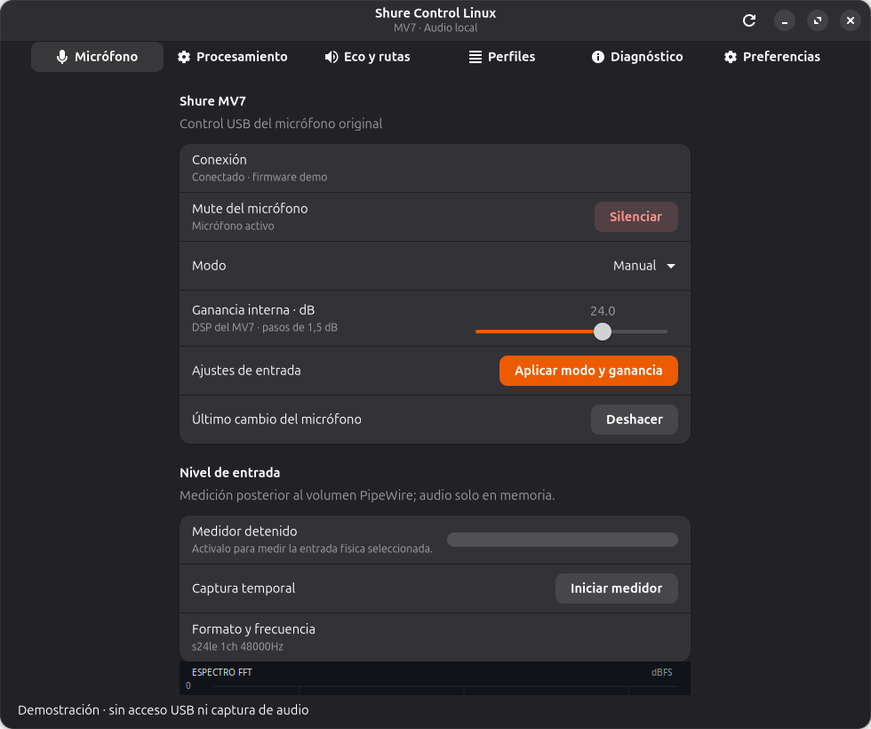
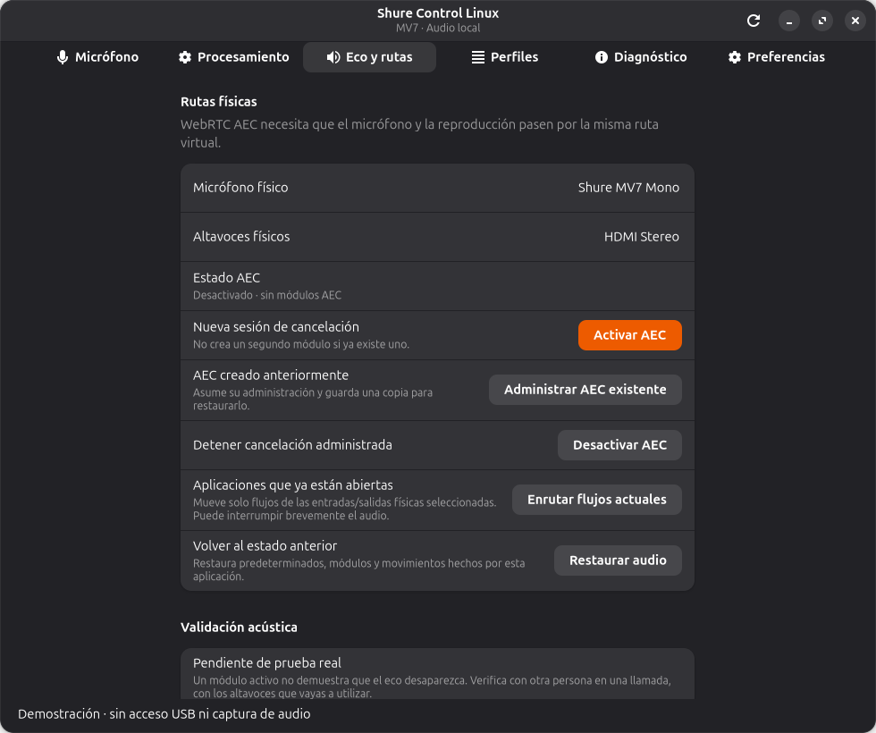
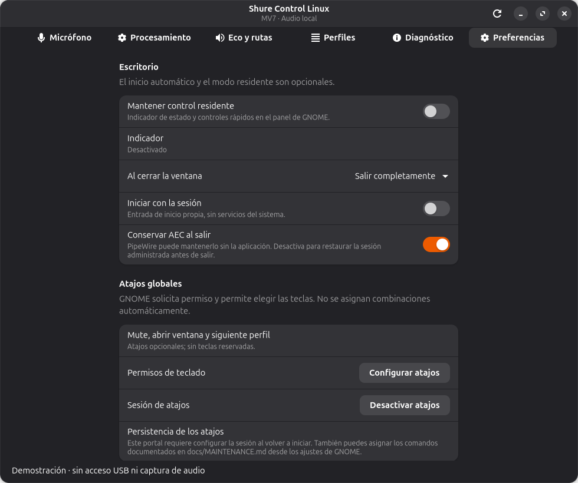

<div align="center">
  
  <h1>Shure Control Linux</h1>
  <p>A native Ubuntu desktop controller for the original Shure MV7, with reversible PipeWire echo cancellation.</p>
</div>

**Independent, unofficial software. Not affiliated with, endorsed by, or supported by Shure Incorporated.** Shure and MV7 are trademarks of their respective owners. This project does not update microphone firmware.

Shure Control Linux combines a GTK4/libadwaita interface with the open-source [shurectl](https://github.com/Humblemonk/shurectl) USB controller and PipeWire's WebRTC acoustic echo cancellation (AEC). It runs locally on the computer connected to the microphone. No account, cloud service, API key, or Raspberry Pi is required.

**Status:** experimental, version **0.2.1**. The interface currently uses **Spanish**; this documentation is in English. Hardware controls and AEC lifecycle have been tested on an original MV7. **Acoustic echo reduction during a real call has not yet been validated.**

## Screenshots

These are captures of the actual GTK interface rendered with deterministic demonstration data, without USB access, audio capture, account information, or private device identifiers. They illustrate the UI, not measured acoustic performance.



<details>
<summary>Echo cancellation and desktop preferences</summary>



</details>

## Features

- Original MV7 identification, live connection/mute state and manual gain in 1.5 dB steps.
- Manual/automatic modes, supported EQ presets, compressor, limiter when readable, automatic tone/distance settings and Monitor Mix.
- Separate PipeWire volume controls; system volume is not the microphone's internal gain.
- WebRTC AEC with an explicitly selected physical microphone and speaker output.
- Reversible routing, duplicate-AEC prevention, explicit adoption of an existing AEC, and protection against external route/volume changes.
- Safe recovery from obsolete AEC journals when the old session has disappeared.
- Local presets, a user-defined profile, and private settings/backups.
- On-demand peak/RMS, waveform and FFT visualization. Samples stay in memory; the application does not save recordings.
- Optional resident controller, StatusNotifierItem tray menu, login autostart and desktop-portal shortcuts.
- One application instance shared by the window, tray and command line.

Named service profiles are only local presets. They do not connect to those services or contain account data. See [architecture and privacy](docs/ARCHITECTURE.md).

## Compatibility

| Component | Requirement / tested status |
| --- | --- |
| Microphone | **Original Shure MV7**, USB VID:PID **14ed:1012** |
| Other Shure models | Not supported by this application, even if upstream shurectl supports them |
| Operating system | Ubuntu Linux; tested on Ubuntu 26.04.1 LTS, amd64 |
| Python | 3.11 or newer, with system PyGObject and Cairo bindings |
| Desktop libraries | GTK 4.10+ and libadwaita 1.5+; tested with GTK 4.22/libadwaita 1.9 |
| Audio | PipeWire, its PulseAudio compatibility service, `pactl`, `parec`, and the WebRTC AEC SPA plugin |
| USB access | User access to the MV7 HID nodes; see [USB permissions](docs/USB-ACCESS.md) |
| Build | Rust/Cargo 1.89+, C compiler, pkg-config, ALSA/udev/PulseAudio development libraries |
| Optional tray | A desktop StatusNotifierItem/AppIndicator host; GNOME support varies |
| Optional shortcuts | A working GlobalShortcuts desktop portal |

Older Ubuntu versions may lack the required libadwaita API. Other distributions, architectures, desktop portals, hotplug recovery and OS-session restart behavior are not fully validated. Read the [test matrix and known limitations](docs/TESTING.md).

## Build and install

This first public publication is **source-only**. No precompiled controller, local development archive, or binary release is uploaded. shurectl is pinned as a Git submodule so its original source, license and history remain separate.

1. Clone the source and the pinned controller:

   ```sh
   git clone --recurse-submodules https://github.com/gabrielstroya/shure-control-linux.git
   cd shure-control-linux
   ```

2. Install dependencies on a compatible Ubuntu system:

   ```sh
   sudo apt update
   sudo apt install git build-essential pkg-config python3 python3-venv \
     python3-gi python3-gi-cairo gir1.2-gtk-4.0 gir1.2-adw-1 \
     pipewire pipewire-pulse wireplumber libspa-0.2-modules pulseaudio-utils \
     libasound2-dev libudev-dev libpulse-dev
   ```

   Install a Rust toolchain **1.89 or newer** through your distribution or [the official Rust installer](https://www.rust-lang.org/tools/install). Check `rustc --version` and `cargo --version`. The dependency commands are instructions for your machine; the application installer never runs them or restarts audio services.

3. Build only the production controller with the committed lockfile:

   ```sh
   cargo build --locked --release --bin shurectl \
     --manifest-path integrations/shurectl/Cargo.toml
   ```

   Do not enable the upstream `probe` or `qa` features for a user installation. An optional amd64-only build helper that extracts development packages locally is described in [installation details](docs/INSTALLATION.md).

4. Configure the narrowly scoped [MV7 udev rule](docs/USB-ACCESS.md), then install as your normal user:

   ```sh
   /usr/bin/python3 scripts/install.py
   ~/.local/bin/shure-control-linux
   ```

   The installer creates a user-local virtual environment using the system GI libraries, desktop entry and original icon. It does not use pip, install system packages, enable autostart, or run the application as root.

For development, run `/usr/bin/python3 -m app.main` from the checkout after building shurectl. `SHURECTL_BIN` can select a controller binary for development; the installer uses the built controller in the checkout.

## Using echo cancellation

Open **Eco y rutas**, select the physical microphone and speakers, then choose **Activar AEC**. For an existing compatible session, explicit **Administrar AEC existente** is required. The virtual devices are `scl_mic_aec` and `scl_speakers_aec`.

Choose the virtual microphone **and** virtual speaker output in your call application. An already-running application's streams may not follow a default-device change; routing existing streams is a separate explicit action. AEC needs the playback reference from the same speaker path. A loaded module alone does not demonstrate that the far end hears less echo.

**Desactivar AEC** removes the managed module. **Restaurar audio** restores the saved session when ownership and external-change checks permit it. If another program changed a route or volume, review the current state instead of forcing restoration. An obsolete journal is archived privately and reconciled only when the missing-session checks succeed.

AEC runs in PipeWire and can remain active after the window closes. **Preferencias → Conservar AEC al salir** controls full-exit restoration. See [usage and maintenance](docs/MAINTENANCE.md).

## Command line

```sh
shure-control-linux --show
shure-control-linux --status
shure-control-linux --background
shure-control-linux --toggle-mute
shure-control-linux --next-profile
shure-control-linux --restore-audio
shure-control-linux --quit
```

Use the full `~/.local/bin/shure-control-linux` path if that directory is not on `PATH`. `--status` and `--diagnose` emit local JSON; review diagnostics before sharing because device names and process information can identify your environment. Mutating commands act on the real connected microphone or audio session.

## Update or uninstall

Close the application completely before updating:

```sh
~/.local/bin/shure-control-linux --quit
git pull --ff-only
git submodule update --init --recursive
cargo build --locked --release --bin shurectl --manifest-path integrations/shurectl/Cargo.toml
/usr/bin/python3 scripts/install.py
```

The installer keeps previous releases and user preferences. To uninstall, first restore any audio session you want to undo, exit completely, then run:

```sh
/usr/bin/python3 scripts/uninstall.py
```

User settings/backups and the udev rule are retained. [Maintenance](docs/MAINTENANCE.md) covers rollback, autostart, optional data removal and udev reversal.

## Tests and contributing

```sh
GSK_RENDERER=cairo /usr/bin/python3 -m unittest discover -s tests -v
```

Tests use fake transports and do not touch USB hardware or change PipeWire. On a headless machine use `xvfb-run -a` with a session D-Bus. Hardware/AEC scripts require explicit opt-in flags and may change live settings temporarily; consult [TESTING.md](docs/TESTING.md) before running them. Documentation screenshots can be reproduced without hardware with `scripts/capture_screenshots.py`.

Contributions are welcome. See [CONTRIBUTING.md](CONTRIBUTING.md) and [SECURITY.md](SECURITY.md). Please do not attach voice recordings, credentials, device serial numbers or unreviewed diagnostic logs to public issues.

## License and credits

Original project code, documentation and the original application icon are offered under **GNU GPL version 3 only (GPL-3.0-only)**. See [LICENSE](LICENSE) and [COPYRIGHT](COPYRIGHT).

- **[Humblemonk/shurectl](https://github.com/Humblemonk/shurectl)** provides USB control. We use unmodified **2.18.1**, commit `09599a1c7715604f4afd2c4894b4bf5b52bd0c21`, under GPL-3.0-only. Its authors retain their copyrights and notices.
- **GTK, libadwaita and PyGObject** provide the native desktop interface.
- **PipeWire and WebRTC** provide the audio infrastructure and AEC engine.
- The microphone icon in this repository is the project's original artwork, not Shure's corporate logo.

Third-party components retain their own licenses. [THIRD_PARTY_NOTICES.md](THIRD_PARTY_NOTICES.md) documents dependencies and source-distribution obligations. GPL licensing does not grant trademark rights or imply endorsement. No proprietary Shure software or firmware is included.
